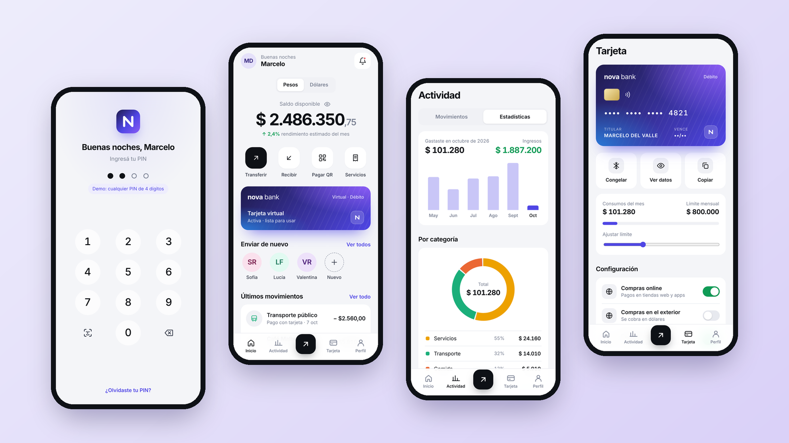
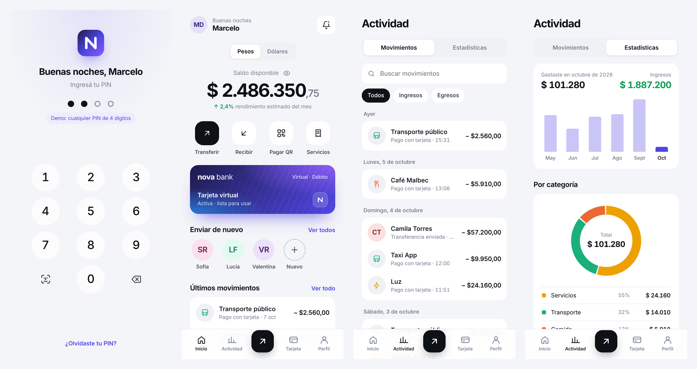
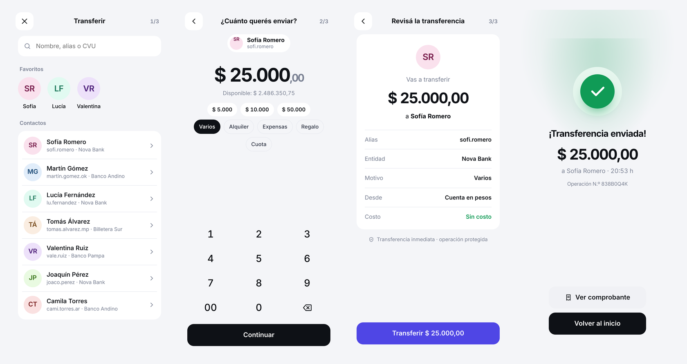
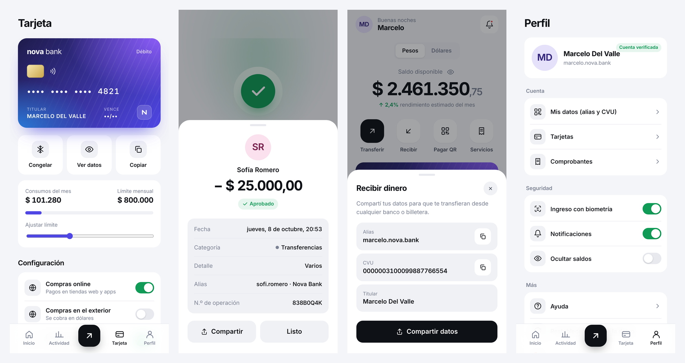
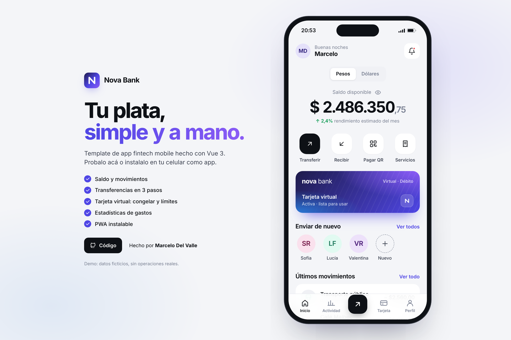

<div align="center">

# Nova Bank

**Template de app fintech mobile — minimalista, rápida e instalable (PWA).**

Vue 3 · Vue Router · Pinia · Vite · PWA

[**Ver demo**](https://cheloxnz.github.io/nova-bank/) · [Portfolio](https://cheloxnz.github.io/)



</div>

## ✨ Funcionalidades

- **Ingreso con PIN** (teclado numérico propio) y acceso "biométrico" simulado.
- **Inicio**: saldo en pesos y dólares, ocultar saldo, accesos rápidos, tarjeta, contactos frecuentes y últimos movimientos.
- **Transferencias en 3 pasos**: destinatario (contactos, búsqueda, alias o CVU nuevo) → monto con teclado y validación de saldo → confirmación → comprobante.
- **Recibir dinero**: alias y CVU con copiar/compartir.
- **Tarjeta virtual**: ver datos (se ocultan solos a los 8 s), congelar/descongelar, límite mensual ajustable y controles de compras online, exterior y sin contacto.
- **Actividad**: movimientos agrupados por día, búsqueda y filtros de ingresos/egresos, detalle de cada operación.
- **Estadísticas**: gasto de los últimos 6 meses (barras con tooltip) y distribución por categoría (donut interactivo + tabla con montos).
- **Perfil** con preferencias, restablecer demo y cerrar sesión.
- **PWA**: manifest, íconos y service worker — se puede instalar en el celular y abre sin barra del navegador.
- Estado persistido en `localStorage`. En desktop se muestra dentro de un marco de teléfono; en mobile ocupa la pantalla completa.

> ⚠️ Proyecto demo: personas, montos y números de tarjeta son ficticios. No realiza operaciones reales.

## 📸 Capturas

**Ingreso, inicio y actividad**


**Flujo de transferencia**


**Tarjeta, comprobante, recibir y perfil**


**Vista desktop**


## 🧱 Estructura

```
src/
├── components/   # BankCard, TxItem, Sheet (bottom sheet), TabBar, Avatar, Icon…
├── views/        # Lock, Home, Activity (+ estadísticas), Transfer, Card, Profile
├── stores/       # Pinia: saldos, movimientos, tarjeta, preferencias (persistido)
├── data/         # Datos de ejemplo generados relativos a la fecha actual
└── router.js     # Hash history + guard de sesión
public/
├── manifest.webmanifest, sw.js, icons/   # PWA
```

## 🚀 Correr localmente

```bash
npm install
npm run dev      # http://localhost:5173/nova-bank/
npm run build
```

## 🌐 Deploy

Cada push a `main` publica en GitHub Pages con `.github/workflows/deploy.yml`
(**Settings → Pages → Source: GitHub Actions**).

---

Hecho por [Marcelo Del Valle](https://cheloxnz.github.io/) · [LinkedIn](https://www.linkedin.com/in/chelodelvalle/)
